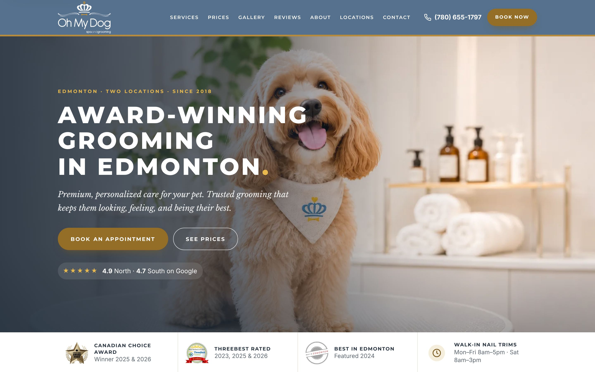
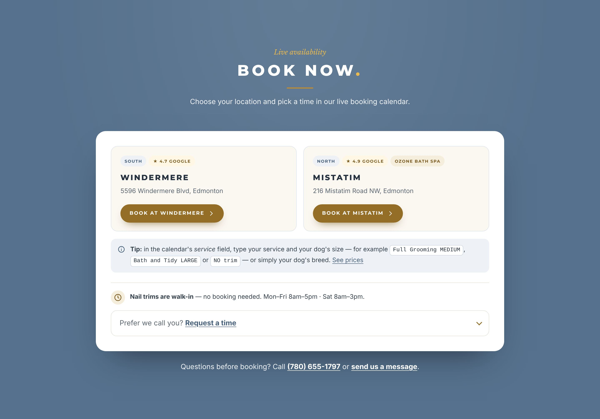
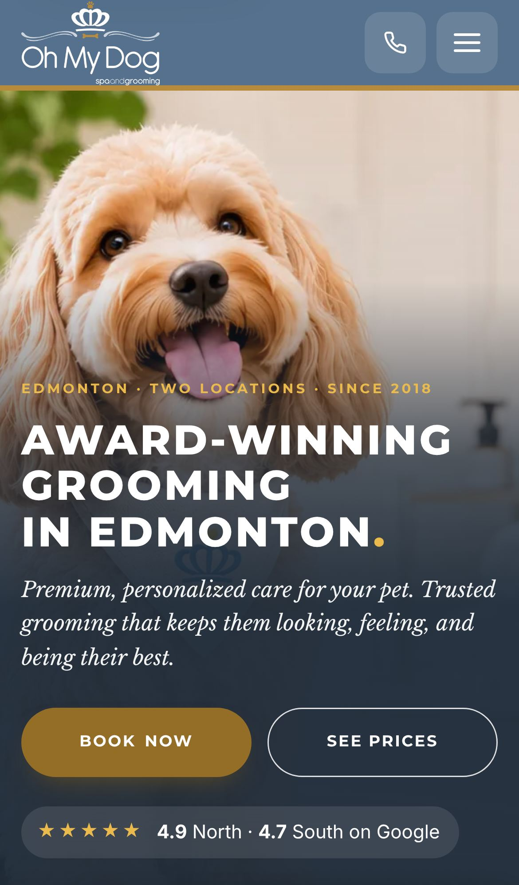
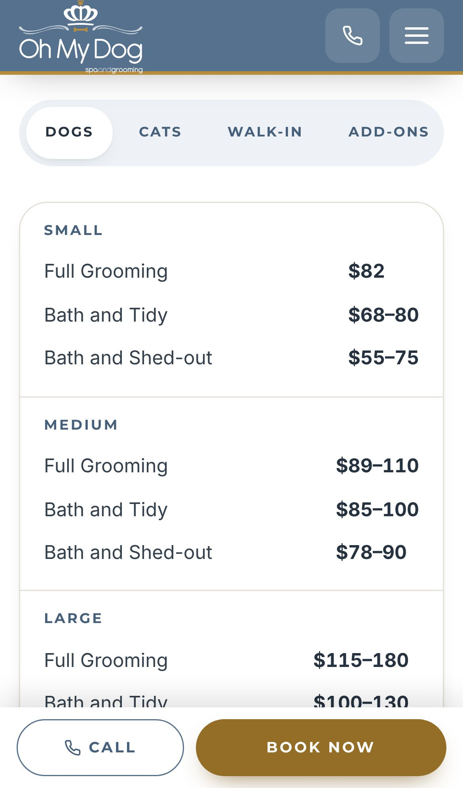

# Oh My Dog Spa & Grooming — site

Site institucional da **Oh My Dog Spa & Grooming**, pet spa com duas unidades em Edmonton (AB, Canadá):

- **South · Windermere:** 5596 Windermere Blvd
- **North · Mistatim:** 216 Mistatim Road NW

O site substitui o site atual em Wix (ohmydogspa.ca). Ele mantém a identidade visual da marca (azul, dourado e a coroa) e corrige os problemas do site atual: o agendamento aparecia cortado, a nota do Google estava errada, o mapa da unidade Norte estava errado e os preços eram imagens difíceis de ler no celular.

| Computador | Agendamento |
|---|---|
|  |  |

| Celular | Preços no celular |
|---|---|
|  |  |

---

## Visão geral

- **Site estático de uma página:** HTML, CSS e JavaScript puro. **Não tem build nem dependências** (sem npm e sem framework).
- **Conteúdo em inglês** (en-CA), para o público de Edmonton.
- **Fontes:** Montserrat (títulos) e Libre Baskerville itálico (detalhes), pelo Google Fonts. O texto corrido usa a fonte do sistema.
- **Agendamento:** fica todo no **DaySmart Pet**, o sistema que a loja já usa. O site não guarda agendamentos.
- **Seções:** Hero · Prêmios · Serviços · Preços · Agendamento · Galeria · Avaliações e prêmios · Sobre · FAQ · Unidades · Contato.

## Estrutura

```text
.
├── index.html      # todo o conteúdo, metadados e dados estruturados (JSON-LD)
├── styles.css      # estilos; cores e fontes em variáveis no :root
├── app.js          # interações e CONFIGURAÇÃO (topo do arquivo)
├── robots.txt
├── sitemap.xml
├── assets/         # imagens otimizadas (WebP), ícones e imagem de compartilhamento
└── preview/        # capturas de tela usadas neste README (não são usadas pelo site)
```

## Rodar localmente

Qualquer servidor estático serve. Com Python:

```bash
python3 -m http.server 8080
```

Depois abra http://localhost:8080.

Para testar no celular, conecte o celular na mesma rede Wi-Fi e abra `http://IP-DO-COMPUTADOR:8080`.

## Configuração

Tudo fica no topo do `app.js`:

```js
const CONFIG = {
  formEndpoint: '',      // URL que recebe os formulários (ex.: Formspree)
  whatsappNumber: '',    // só dígitos, com código do país (ex.: "17805551234")
  email: 'info@ohmydogspa.ca',
  phoneLabel: '(780) 655-1797',
  phoneHref: 'tel:+17806551797',
};
```

| Chave | Comportamento |
|---|---|
| `formEndpoint` | **Vazio:** o formulário de contato e o "Request a time" abrem o aplicativo de e-mail do visitante, com a mensagem já preenchida, e a página avisa isso. **Preenchido:** os dados vão por `POST` em JSON (`Content-Type: application/json`) e a página confirma o envio. Se o envio falhar, a página oferece telefone e e-mail. |
| `whatsappNumber` | **Vazio:** todos os botões de WhatsApp ficam escondidos. **Preenchido:** os botões aparecem. |
| `email`, `phoneLabel`, `phoneHref` | São usados pelos textos gerados no JavaScript. |

### Ativar o envio real dos formulários (Formspree)

1. Crie um formulário em [formspree.io](https://formspree.io) com o e-mail da loja.
2. Copie o endpoint (`https://formspree.io/f/xxxxxxx`) para `formEndpoint`.
3. Envie um teste por cada formulário e confirme que chegou na caixa de entrada.

Os dois formulários têm um campo escondido (*honeypot*) contra spam. Qualquer outro serviço ou backend que aceite JSON também funciona.

### Mudou o telefone ou o e-mail?

Eles aparecem também em vários pontos do `index.html`: cabeçalho, agendamento, contato, rodapé e JSON-LD. Busque por `655-1797`, `6551797` e `info@ohmydogspa.ca`, e altere `app.js` e `index.html` juntos.

## Agendamento (DaySmart)

Os links de agendamento de cada unidade estão em `LOCATIONS`, no `app.js`, e nos `href` dos links com `data-book-location` no `index.html`. Se o DaySmart mudar o endereço, atualize os dois arquivos.

- **Computador** (tela de 900 px ou mais): ao escolher a unidade, o calendário do DaySmart abre dentro da página. Se não carregar em 15 s, aparece um link para abrir em nova aba.
- **Celular e tablet:** o link abre o DaySmart em nova aba. No celular, o próprio plugin do DaySmart só mostra um botão para essa mesma página.
- **"Request a time":** formulário para quem prefere que a loja ligue de volta. Segue a regra do `formEndpoint` explicada acima.

O site **não** usa o script oficial do plugin do DaySmart. Esse script coloca o calendário numa caixa de 350 px de altura que esconde o botão "Show Available Times", e era isso que cortava o agendamento no site antigo.

O DaySmart tem cerca de 200 opções de serviço. A dica na seção de agendamento sugere o que digitar na busca (ex.: `Full Grooming MEDIUM`, `NO trim`). Se os nomes dos serviços mudarem no DaySmart, atualize essa dica.

## Editar o conteúdo

| O quê | Onde |
|---|---|
| Preços | `index.html`, seção `#prices` (abas Dogs, Cats, Walk-in e Add-ons). Cada `<td>` tem `data-label`, que o celular usa para mostrar o nome da coluna. Mantenha esse atributo ao adicionar linhas. |
| Serviços | `index.html`, seção `#services`. O detalhe que abre ao clicar vem do `.svc-more` de cada cartão. Imagens: `assets/svc-*.webp`, 336 × 336. |
| Galeria | `assets/gallery-N.webp` (768 × 960) e `assets/gallery-N-sm.webp` (480 × 600). Para adicionar uma foto, gere os dois tamanhos e copie um item existente da seção `#gallery`. |
| Notas do Google | `index.html`, seção `#reviews` (e os selos da seção de agendamento). **São números fixos:** atualize de vez em quando com os perfis oficiais no Google Maps. |
| Horário do walk-in | Aparece em vários pontos do `index.html` (barra de prêmios, serviços, preços, agendamento, FAQ e rodapé). Busque por `8am`. |
| Cores e fontes | Variáveis no `:root` do `styles.css` (`--blue-600`, `--gold-600`, `--display`, `--serif`, `--body` etc.). |

Use imagens **WebP**, no tamanho em que aparecem, e sempre com `width`, `height` e `alt`.

## SEO

- Título, descrição, Open Graph (`assets/og-image.jpg`, 1200 × 630) e URL canônica `https://www.ohmydogspa.ca/`.
- JSON-LD com `Organization` e um `LocalBusiness` para cada unidade (endereço, coordenadas e link do Google Maps).
- `robots.txt` e `sitemap.xml`.

Se o domínio final não for `https://www.ohmydogspa.ca/`, troque a URL no `index.html` (canonical, Open Graph e JSON-LD), no `robots.txt` e no `sitemap.xml`.

## Acessibilidade e qualidade

- Auditoria automática com axe-core (WCAG 2.1 AA) **sem violações** na entrega.
- Testado em larguras de computador, tablet e celular (até 360 px).
- Link "Skip to main content", navegação por teclado, foco visível, `prefers-reduced-motion` respeitado.
- **Sem JavaScript**, o conteúdo continua visível e os links de agendamento, telefone e e-mail funcionam. Os formulários precisam de JavaScript.
- Mapas do Google e imagens abaixo da dobra carregam só quando necessários.

### Checklist antes de publicar

- [ ] Os dois botões "Book at…" abrem o DaySmart da unidade certa (no computador e no celular).
- [ ] "Request a time" e o formulário de contato chegam ao e-mail da loja (ou abrem o e-mail do visitante, se `formEndpoint` estiver vazio).
- [ ] Os links de telefone ligam para (780) 655-1797.
- [ ] Os mapas e os links "Read & write reviews" abrem a unidade correta.
- [ ] Os preços batem com a tabela atual da loja.
- [ ] O menu, a galeria e a barra inferior funcionam no celular.

## Publicação

Por ser estático, o site roda em qualquer hospedagem estática, como **Netlify**, **Cloudflare Pages** ou **GitHub Pages**:

1. Conecte este repositório à hospedagem.
2. **Comando de build:** nenhum. **Pasta publicada:** a raiz (`/`).
3. Adicione o domínio `www.ohmydogspa.ca` como principal e redirecione `ohmydogspa.ca` para ele.
4. Altere o DNS do domínio, hoje no Wix, para apontar para a nova hospedagem. **Só depois desse passo** o site antigo sai do ar.
5. Confira o HTTPS e rode o checklist acima no endereço final.
6. Envie o `sitemap.xml` no Google Search Console e confira o site informado nos Perfis da Empresa no Google das duas unidades.

## Pendências para confirmar com a loja

O site novo usa os dados do site atual (versão de computador). Estes pontos têm divergência e **ainda não foram alterados**:

1. **Preço do gato:** no celular, o site atual mostra $110 e $85; no computador, $120 e $90. O site novo usa $120 e $90.
2. **CEP da unidade Sul:** o site diz T6W 2Z8; o Google diz T6W 2P3.
3. **Ozone Bath Spa:** o site diz que é só no Norte, mas no DaySmart aparece só na unidade Sul.
4. **Adicionais "Extra deshedding" e "Extra trim":** no site atual aparecem como $0.00. O site novo mostra "Quoted in person".
5. **WhatsApp e horário das lojas:** confirmar se existe WhatsApp de atendimento e se o horário pode aparecer no site.
6. **Fotos:** equipe e antes e depois, se a loja quiser essas seções.

## Direitos

Marca, logotipo, fotos e textos pertencem à Oh My Dog Spa & Grooming. Não reutilize sem autorização.
